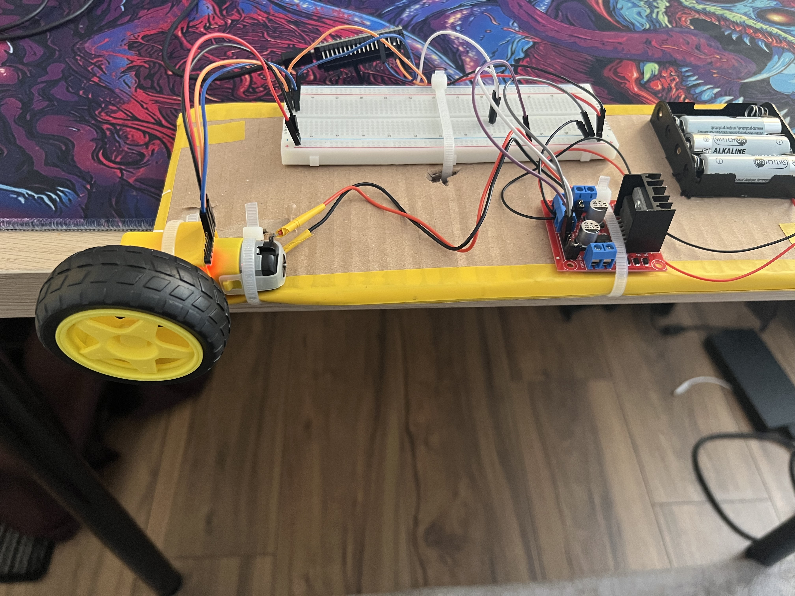
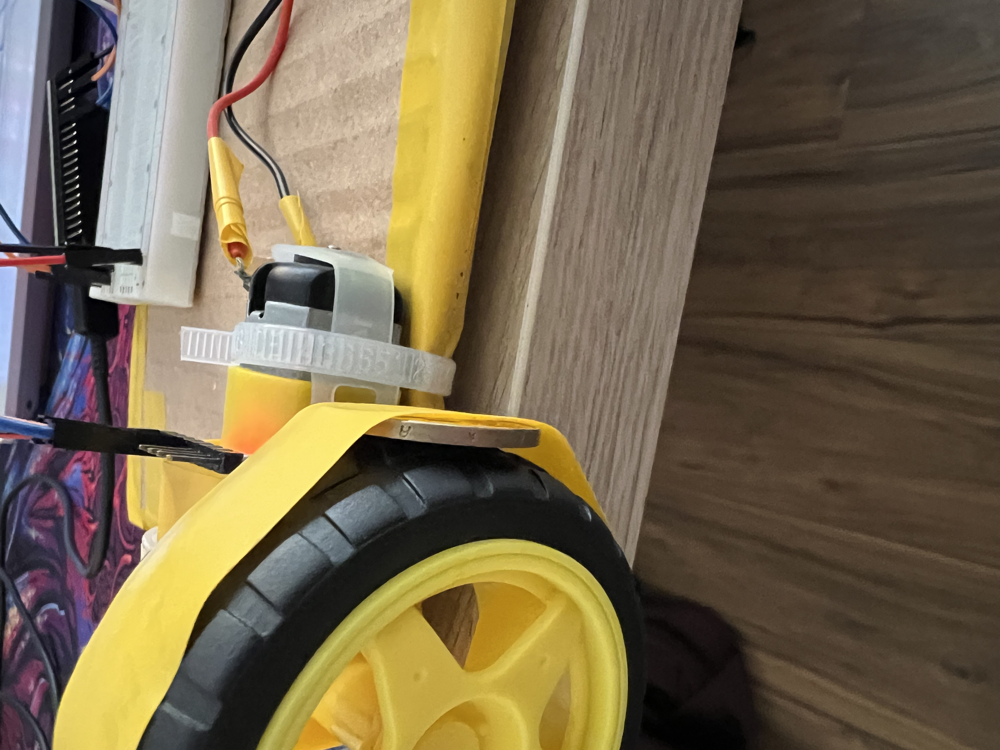
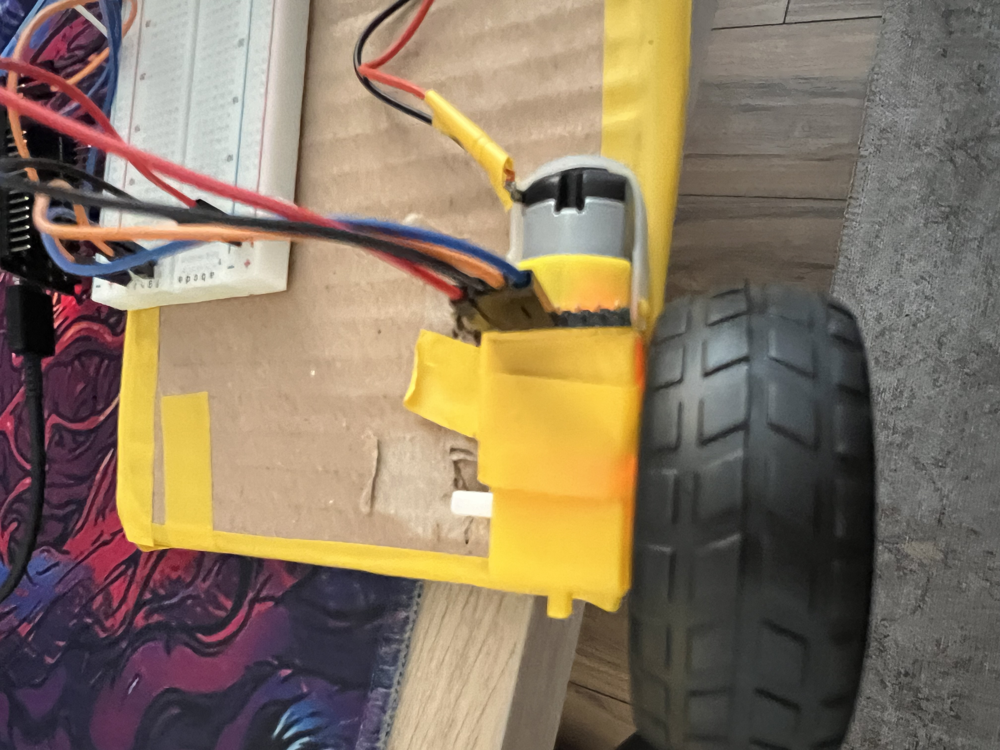
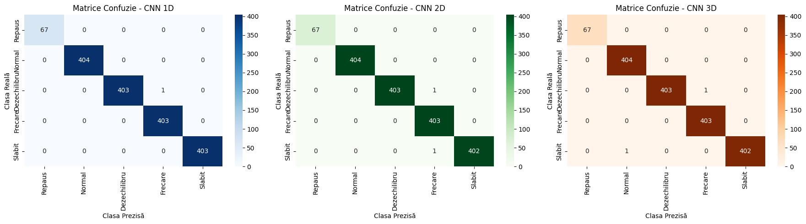

# Mentenanță predictivă pe ESP32 cu rețea convoluțională 1D

Lucrare de licență. Sistemul clasifică în timp real starea unui motor de curent continuu
pornind de la vibrațiile măsurate cu un accelerometru/giroscop MPU6050. Inferența rulează
direct pe microcontroler (ESP32), fără conexiune la un server.

Cele cinci clase: `0 = Repaus`, `1 = Normal`, `2 = Dezechilibru`, `3 = Frecare`,
`4 = Slăbit` (fixare slabă).

Parametri de achiziție și model, identici între colectare, antrenare și inferență:

| Parametru | Valoare |
|---|---|
| Frecvență eșantionare | 100 Hz |
| Caracteristici | `ax, ay, az, gx, gy, gz` (m/s², rad/s) |
| Fereastră / pas | 128 / 64 (50% suprapunere) |
| Senzor | MPU6050, ±16 G, ±500 °/s, filtru 21 Hz |
| Pini | I2C pe 21/22, PWM motor pe 14 |
| Placă | ESP32 DOIT DevKit v1 |

## Montaj experimental


Motorul de curent continuu e comandat prin PWM de la ESP32 (pin 14), iar senzorul
MPU6050 e fixat pe carcasa motorului și citit pe I2C. Cele patru defecte au fost provocate
fizic, nu simulate: masă adăugată excentric pe ax (dezechilibru), contact abraziv pe
carcasă (frecare) și șuruburi de prindere slăbite (fixare slabă).

| Normal | Dezechilibru | Frecare | Fixare slabă |
|---|---|---|---|
|  |  |  |  |

Fiecare condiție a fost înregistrată la șase turații (PWM 160, 180, 200, 220, 240, 255),
câte ~5 minute per combinație, plus o înregistrare de zgomot cu motorul oprit.

## Rezultate

Setul sesiunii 1, împărțit secvențial 80/20 în interiorul fiecărei combinații
clasă × turație. Ferestre de 128 eșantioane: 6.727 la antrenare, 1.681 la test.

| Metodă | Acuratețe |
|---|---|
| Prag fix pe amplitudine, fără ML | 0,28 |
| K-Means pe caracteristici extrase | 0,85 |
| SVM | 1,00 |
| Random Forest | 1,00 |
| CNN 1D | 1,00 |
| CNN 2D | 1,00 |
| CNN 3D | 1,00 |

Pragul fix a fost evaluat pe eșantioane individuale (8.411), restul pe ferestre (1.681).
Matricele de confuzie sunt în `lucrare/images/` (`baseline_cm.png`, `k_means_cm.png`,
`svm_cm.png`, `random_forest_cm.png`, `cnn_cm.png`).

| CNN 1D | Prag fix |
|---|---|
|  |  |

Diferența dintre 0,28 și 1,00 arată că defectele nu se separă pe amplitudinea brută a
vibrației, ci pe forma semnalului. Metodele clasice pe caracteristici extrase
(medie, deviație standard, RMS) ajung și ele la același rezultat, deci problema nu cere
neapărat o rețea; CNN 1D a fost aleasă pentru că nu necesită extragere manuală de
caracteristici și încape pe microcontroler.

Acuratețea de 1,00 trebuie citită cu rezerva că împărțirea e secvențială: ferestrele
vecine se suprapun 50% și provin din aceeași înregistrare continuă, deci setul de test
nu e complet independent de cel de antrenare.

CNN 1D are 3.093 de parametri; după cuantizare INT8 modelul ocupă 11.560 de octeți în
memoria flash a plăcii.

## Structura

| Folder | Conținut |
|---|---|
| `firmware/` | Inferență pe ESP32, varianta finală, modulară, cu dashboard web pe SoftAP |
| `firmware-legacy/` | Prima variantă, monolitică; conține și varianta cu ecran OLED |
| `colectare-date/` | Firmware de achiziție, scripturi de logare și datele brute |
| `model/` | Notebook-uri de antrenare, artefacte de model, scripturi de analiză |
| `lucrare/` | Sursele LaTeX ale lucrării și `main.pdf` |
| `docs/` | Declarație pe proprie răspundere, referat coordonator |

## Proveniența datelor și a modelelor

Au existat două sesiuni de colectare, cu montaje diferite ale senzorului. Fiecare are
propriul scaler (`StandardScaler`), iar **scalerul nu este interschimbabil între
sesiuni** — un scaler nepotrivit deplasează distribuția de intrare și predicțiile devin
greșite fără eroare vizibilă.

| Firmware | Date brute | Rânduri | `kInputMean[0]` din `preprocessing.h` |
|---|---|---|---|
| `firmware/` | `colectare-date/date_raw_2026_06/` | 324.064 | `0.002488` |
| `firmware-legacy/` | `colectare-date/date_raw_2025_12/` | 538.327 | `0.163085` |

Artefactele sesiunii 1 stau în `model/`, cele ale sesiunii 2 în `model/run_2026_06/`.

## Cum se rulează

### 1. Colectarea datelor

Se încarcă `colectare-date/firmware/` pe ESP32 (PlatformIO). Placa trimite pe serial, la
100 Hz, linii `ax,ay,az,gx,gy,gz,temp`.

```
cd colectare-date
python date_logger.py     # scrie un CSV per condiție și turație
```

Portul serial, numele fișierului, eticheta și durata se setează în capul scriptului,
înainte de fiecare înregistrare.

### 2. Unificarea într-un singur set de date

`dataset_final.csv` nu este ținut în repo; se regenerează din datele brute:

```
cd colectare-date
python date_master.py
```

Scriptul deduce eticheta și turația din numele fișierului și scrie `dataset_final.csv`
(538.327 rânduri pentru sesiunea 1). Pentru sesiunea a doua se schimbă
`MASTER_DIRECTORY` în `date_raw_2026_06`.

Fișierul rezultat se copiază în `model/`, respectiv `model/run_2026_06/`.

### 3. Antrenarea

`model/CNN1_2_3D.ipynb` compară variantele CNN 1D, 2D și 3D și exportă modelul cuantizat
INT8. Setul de date se alege din variabila `DATASET` din prima celulă. Notebook-ul scrie
`model_cnn1d_int8.h` (tabloul de greutăți) și parametrii scalerului.

`model/analiza_vibratii.py` face analiza exploratorie: scorul de vibrație pe clase și
spectrul FFT. `model/data_view.py` verifică balanța claselor.

### 4. Rularea pe placă

`model_cnn1d_int8.h` și `preprocessing.h` se copiază în `firmware/include/`, apoi:

```
cd firmware
pio run -t upload
```

Placa pornește un punct de acces WiFi (`Mentenanta-ESP32`). Dashboard-ul cu predicția,
probabilitățile pe clase și osciloscopul celor șase canale e la `http://192.168.4.1`.

Achiziția și inferența rulează pe Core 1, serverul web pe Core 0. Cu `DIAGNOSTIC_MODE 1`
firmware-ul afișează pe serial media ferestrei curente față de media de antrenare — util
pentru a prinde un senzor remontat altfel decât la colectare.

## Note

- `firmware-legacy/src/` conține trei variante cu `setup()`/`loop()`; se compilează una
  singură, selectată din `build_src_filter` în `platformio.ini`.
- Modelele mari (`.keras`) și seturile de date unificate nu intră în repo; se regenerează
  din notebook-uri, respectiv din `date_raw`.
