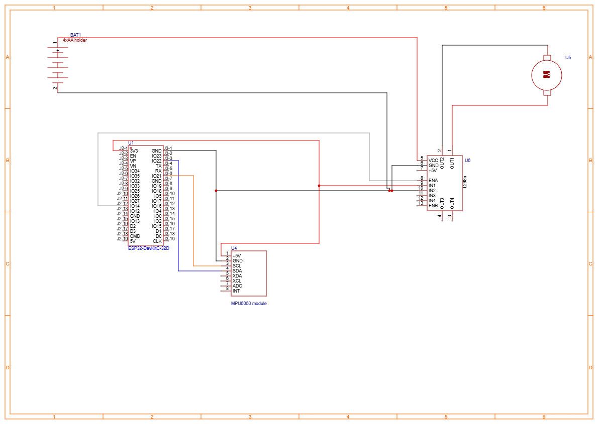
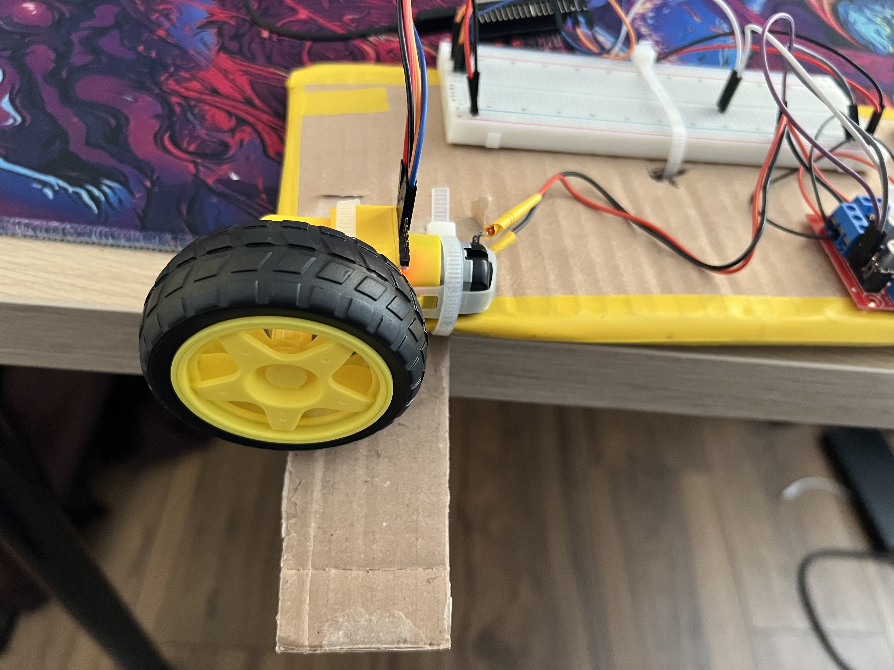
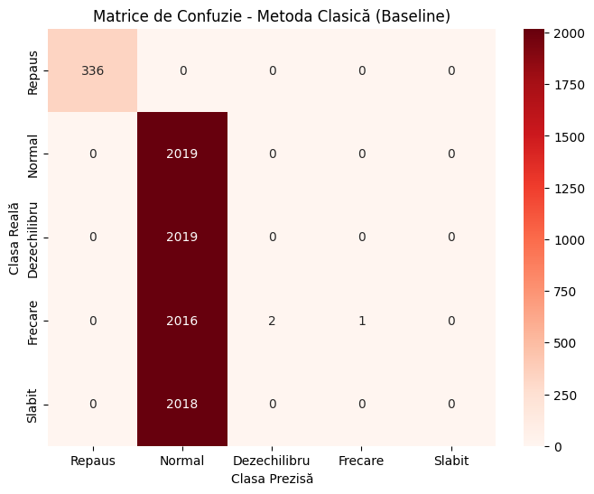

# Predictive maintenance on ESP32 with a 1D convolutional network

Bachelor's thesis project. The system classifies the running state of a DC motor in real
time from vibration measured with an MPU6050 accelerometer/gyroscope. Inference runs
directly on the microcontroller with TensorFlow Lite for Microcontrollers, with no server
involved, and the current classification is shown on a web page hosted by the board
itself.

Five classes, named in the code as `Repaus`, `Normal`, `Dezechilibru`, `Frecare`,
`Slabit` — idle, healthy, imbalance, friction, loose mounting.

The thesis itself is written in Romanian (`lucrare/`), and so are the source comments.
This documentation is in English.

| Parameter | Value |
|---|---|
| Sampling rate | 100 Hz |
| Features | `ax, ay, az, gx, gy, gz` (m/s², rad/s) |
| Window / stride | 128 / 64 (50% overlap) |
| Sensor | MPU6050, ±16 G, ±500 °/s, 21 Hz filter |
| Pins | I2C on 21/22, motor PWM on 14 |
| Board | ESP32 DOIT DevKit v1 |

## Experimental setup



The DC motor is driven by PWM from the ESP32 (pin 14), and the MPU6050 is bolted to the
motor housing and read over I2C. The four fault conditions were induced physically, not
simulated: an off-centre mass added to the shaft (imbalance), an abrasive contact against
the housing (friction), and loosened mounting screws (loose fixing).

| Healthy | Imbalance | Friction | Loose mounting |
|---|---|---|---|
|  |  |  |  |

Each condition was recorded at six motor speeds (PWM 160, 180, 200, 220, 240, 255), about
five minutes per combination, plus one recording of the sensor noise floor with the motor
stopped.

## Results

Session 1 data, split sequentially 80/20 within each class × speed combination. Windows of
128 samples: 6,727 for training, 1,681 for test.

| Method | Accuracy |
|---|---|
| Fixed amplitude threshold, no ML | 0.28 |
| K-Means on extracted features | 0.85 |
| SVM | 1.00 |
| Random Forest | 1.00 |
| CNN 1D | 1.00 |
| CNN 2D | 1.00 |
| CNN 3D | 1.00 |

The fixed threshold was evaluated per sample (8,411), the rest per window (1,681).
Confusion matrices are in `lucrare/images/` (`baseline_cm.png`, `k_means_cm.png`,
`svm_cm.png`, `random_forest_cm.png`, `cnn_cm.png`).

| CNN 1D | Fixed threshold |
|---|---|
|  |  |

The gap between 0.28 and 1.00 shows that the faults do not separate on raw vibration
amplitude but on the shape of the signal. Classical methods on extracted features (mean,
standard deviation, RMS) reach the same result, so the problem does not strictly require a
neural network; the CNN 1D was chosen because it needs no hand-crafted feature extraction
and still fits on the microcontroller.

The 1.00 figures should be read with one caveat: the split is sequential, neighbouring
windows overlap by 50% and come from the same continuous recording, so the test set is not
fully independent of the training set.

The CNN 1D has 3,093 parameters; after INT8 quantisation the model occupies 11,560 bytes
of flash.

## Repository layout

Each directory has its own README with details.

| Directory | Contents |
|---|---|
| [`firmware/`](firmware/) | ESP32 inference, final modular version, with a web dashboard over SoftAP |
| [`firmware-legacy/`](firmware-legacy/) | First version, monolithic; also holds the OLED variant |
| [`colectare-date/`](colectare-date/) | Acquisition firmware, logging scripts and the raw data |
| [`model/`](model/) | Training notebooks, model artefacts, analysis scripts |
| [`lucrare/`](lucrare/) | LaTeX sources of the thesis and `main.pdf` |
| [`docs/`](docs/) | Administrative documents |

## Data and model provenance

There were two acquisition sessions, with the sensor mounted differently. Each has its own
`StandardScaler`, and **the scaler is not interchangeable between sessions** — a mismatched
scaler shifts the input distribution and the predictions become wrong without any visible
error.

| Firmware | Raw data | Rows | `kInputMean[0]` in `preprocessing.h` |
|---|---|---|---|
| `firmware/` | `colectare-date/date_raw_2026_06/` | 324,064 | `0.002488` |
| `firmware-legacy/` | `colectare-date/date_raw_2025_12/` | 538,327 | `0.163085` |

Session 1 artefacts live in `model/`, session 2 artefacts in `model/run_2026_06/`.

## Pipeline

```
colectare-date/          model/                         firmware/
  acquisition fw   -->     date_master.py         -->     model_cnn1d_int8.h
  date_logger.py           CNN1_2_3D.ipynb                preprocessing.h
  date_raw_*/              (train + quantise)             (on-device inference)
```

1. Flash the acquisition firmware, record one CSV per condition and speed.
2. Merge the raw CSVs into a single dataset with `date_master.py`.
3. Train and export the quantised model in `model/CNN1_2_3D.ipynb`.
4. Copy the generated `model_cnn1d_int8.h` and `preprocessing.h` into `firmware/include/`
   and flash the board.

Full instructions are in the README of each directory.

## Requirements

- PlatformIO (ESP32 Arduino framework) for the three firmware projects
- Python 3 with `pandas`, `numpy`, `scikit-learn`, `tensorflow`, `matplotlib`, `scipy`,
  `pyserial`
- XeLaTeX (the thesis uses `fontspec`, so `pdflatex` will not build it)

## Notes

Unified datasets (`dataset_final.csv`) and large `.keras` models are not tracked; they are
regenerated from `date_raw` and from the notebooks respectively.
